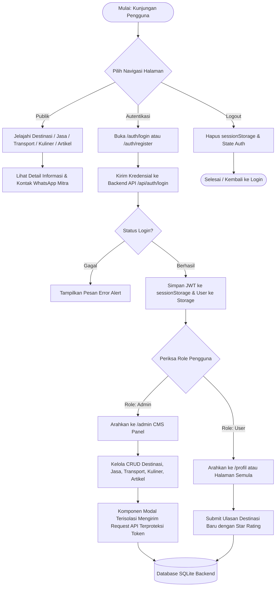

# PANDUAN DAN MATERI LENGKAP PROYEK 1 PABWE (JELAJAH TOBA)
> **Dokumen Master Context untuk AI Generator**: File ini disusun khusus untuk diunggah/dimasukkan ke dalam AI (ChatGPT, Claude, Gemini, dll.) agar dapat secara instan menghasilkan **Dokumen Laporan Proyek 1 (.docx)** sesuai template resmi dan **Script Video Penjelasan YouTube (Clone hingga Running)** sesuai panduan praktikum.

---

## DAFTAR ISI
1. [PROFIL & METADATA PROYEK](#1-profil--metadata-proyek)
2. [BAGIAN I: DOKUMEN LAPORAN PROYEK 1 (SESUAI TEMPLATE RESMI)](#2-bagian-i-dokumen-laporan-proyek-1)
   - [Cover & Identitas](#cover--identitas)
   - [BAB I: PENDAHULUAN](#bab-i-pendahuluan)
   - [BAB II: PERANCANGAN PROGRAM](#bab-ii-perancangan-program)
   - [BAB III: PROSES PEMANFAATAN AI](#bab-iii-proses-pemanfaatan-ai)
   - [BAB IV: EVALUASI KRITIS TERHADAP KODE AI](#bab-iv-evaluasi-kritis-terhadap-kode-ai)
   - [BAB V: PERBAIKAN DAN KEPUTUSAN TEKNIS](#bab-v-perbaikan-dan-keputusan-teknis)
   - [LAMPIRAN](#lampiran)
3. [BAGIAN II: SCRIPT LENGKAP VIDEO YOUTUBE (CLONE HINGGA RUNNING)](#3-bagian-ii-script-lengkap-video-youtube)
   - [Rundown & Struktur Durasi](#rundown--struktur-durasi)
   - [Naskah Script Narasi Per Scene (Full Voiceover)](#naskah-script-narasi-per-scene)
4. [BAGIAN III: PROMPT SIAP PAKAI UNTUK AI (COPY-PASTE INSTRUCTION)](#4-bagian-iii-prompt-siap-pakai-untuk-ai)

---

## 1. PROFIL & METADATA PROYEK

- **Mata Kuliah**: Pengembangan Aplikasi Berbasis Web (PABWE)
- **Judul Proyek**: Pemanfaatan AI dalam Pengembangan Aplikasi JelajahToba Menggunakan Framework Front-End Vue.js dan Back-End Express.js
- **Nama Aplikasi**: **JelajahToba** (Portal Informasi Pariwisata, Layanan Lokal, dan Ekosistem Danau Toba)
- **Penyusun**:
  - **NIM**: 11S24013
  - **Nama**: Rivaldi
  - **Program Studi**: Sarjana Informatika
  - **Fakultas**: Fakultas Informatika dan Teknik Elektro (FITE)
  - **Institusi**: Institut Teknologi Del
  - **Tahun Ajaran**: 2026/2027
- **Teknologi Utama**:
  - **Front-End Framework**: Vue.js 3 (Composition API `<script setup>`, Vite, Vue Router 4, Pinia)
  - **Styling**: Vanilla CSS Modern (Scoped CSS, CSS Variables, Responsive Grid/Flexbox)
  - **Testing**: Vitest + @vitest/coverage-v8 (100% Code Coverage: Statements, Branches, Functions, Lines)
  - **Back-End Framework**: Express.js (REST API, JWT Authentication, CORS)
  - **Database**: SQLite
  - **CI/CD & DevOps**: Jenkins Pipeline (Bun Docker, Vitest Coverage, Trivy Vulnerability Scan, SonarQube Scanner, Quality Gate, UserContent Archiving, Automated Webhook Redeployment)
  - **Hosting / URL Produksi**:
    - Front-End: `https://ifs24013-pabwe2026-proyek1.vercel.app`
    - Back-End API: `https://ifs24013-pabwe2026-proyek1-be.vercel.app/api`
  - **Repository GitHub**: `https://github.com/rivaldi1603/ifs24013-pabwe2026-proyek1`
- **Alat AI yang Digunakan**: Google Antigravity IDE (Gemini 2.5 / DeepMind Agentic Engine) dan ChatGPT (OpenAI GPT-4o)

---

## 2. BAGIAN I: DOKUMEN LAPORAN PROYEK 1

*(Gunakan bagian ini sebagai konten utama untuk mengisi template `template_dokumen_proyek_1_pabwe.docx`)*

### COVER & IDENTITAS
- **Judul**: PEMANFAATAN AI DALAM PENGEMBANGAN APLIKASI JELAJAH TOBA MENGGUNAKAN FRAMEWORK FRONT-END VUE.JS DAN BACK-END EXPRESS.JS
- **Disusun Oleh**: 11S24013 - Rivaldi
- **Instansi**: Program Studi Sarjana Informatika, Fakultas Informatika dan Teknik Elektro, Institut Teknologi Del, Tahun Ajaran 2026/2027.

---

### BAB I: PENDAHULUAN

#### 1.1. Latar Belakang
Kawasan Danau Toba merupakan salah satu Destinasi Pariwisata Super Prioritas (DPSP) di Indonesia yang memiliki kekayaan alam, budaya Batak, dan potensi ekonomi lokal yang tersebar di 8 kabupaten di sekitarnya. Kendati demikian, wisatawan kerap menghadapi kendala fragmentasi informasi terkait destinasi wisata, jasa pemandu lokal, jadwal penyeberangan kapal ferry antar-pelabuhan, kuliner khas halal/non-halal, serta ulasan terverifikasi. Di sisi lain, pelaku UMKM lokal dan pemandu wisata di desa-desa lingkar Danau Toba masih memiliki keterbatasan akses dalam mempromosikan layanan mereka secara terpusat. Untuk mengatasi persoalan tersebut, dirancanglah aplikasi **JelajahToba** sebagai platform terpadu ekosistem pariwisata Danau Toba.

Seiring akselerasi teknologi kecerdasan buatan, kehadiran *Generative AI* seperti Google Antigravity, ChatGPT, Claude, dan GitHub Copilot telah mengubah paradigma rekayasa perangkat lunak secara fundamental. AI tidak hanya mampu mempercepat *prototyping* dan *boilerplate coding*, melainkan juga berperan sebagai asisten interaktif dalam refactoring, pembuatan skenario pengujian, serta identifikasi kerentanan kode. Namun, kode yang dihasilkan AI acap kali mengandung *hallucination*, celah keamanan (seperti kebocoran token pada *storage*, *hardcoded fallback*, atau bypass otentikasi), inefisiensi performa (duplikasi fungsi dan *bundle bloat*), serta pelanggaran aksesibilitas warna. Oleh karena itu, studi kasus ini dipilih guna mengeksplorasi potensi akselerasi pengembangan aplikasi web modern dengan Vue 3 dan Express.js menggunakan Generative AI, sekaligus menguji kemampuan berpikir kritis mahasiswa dalam mengevaluasi, memverifikasi, dan memperbaiki kode secara terukur.

#### 1.2. Rumusan Masalah
Pemanfaatan AI generatif memunculkan peluang besar sekaligus tantangan teknis dalam pengembangan perangkat lunak. Berdasarkan konteks tersebut, rumusan masalah dalam proyek ini adalah:
1. Bagaimana Generative AI dapat dimanfaatkan secara optimal untuk merancang dan membangun arsitektur front-end aplikasi JelajahToba menggunakan Vue 3 dan styling Vanilla CSS?
2. Bagaimana menyusun instruksi (*prompt engineering*) yang efektif dan terstruktur agar AI menghasilkan kode yang modular, aman, dan mudah dipelihara?
3. Apa saja kelemahan, celah keamanan, dan inefisiensi yang muncul pada kode hasil generasi AI dalam konteks arsitektur web modern, aksesibilitas WCAG, dan performa Lighthouse?
4. Bagaimana mengevaluasi secara kritis, mendiagnosis akar masalah (*root cause*), dan merefaktor kode hasil AI agar memenuhi standar *Clean Code*, *Best Practices*, *Project Structure*, dan *Separation of Concerns*?

#### 1.3. Tujuan
Tujuan yang ingin dicapai dalam proyek pengembangan ini adalah:
1. Mengembangkan platform web pariwisata terpadu JelajahToba dengan arsitektur front-end Vue 3 dan back-end Express.js SQLite.
2. Mendokumentasikan alur *prompt engineering* serta interaksi dengan alat AI generatif dalam proses konstruksi aplikasi.
3. Melakukan evaluasi kritis terhadap kualitas kode hasil AI berdasarkan metrik *Clean Code*, keamanan token, aksesibilitas (Axe Core WCAG 2 AA), dan performa (Core Web Vitals).
4. Melakukan perbaikan teknis menyeluruh (*refactoring* modular, penghapusan bypass keamanan, konsolidasi utilitas, dan optimasi bundle) hingga mencapai kepatuhan standar industri dan skor penilaian optimal.
5. Membangun kebiasaan berpikir kritis dan etis dalam memanfaatkan kecerdasan buatan sebagai rekan *pair programming*, bukan penerima hasil mentah tanpa validasi.

#### 1.4. Manfaat
- **Manfaat Teoretis**: Memberikan wawasan empiris mengenai efektivitas dan batasan model AI generatif dalam rekayasa perangkat lunak modern, khususnya integrasi framework Vue 3 dengan REST API Express.js.
- **Manfaat Praktis Bagi Penulis**: Melatih kompetensi *prompting*, keterampilan *debugging* tingkat lanjut, pemahaman standar keamanan aplikasi web (mitigasi XSS pada penyimpanan token), serta kepatuhan *CI/CD pipeline*.
- **Manfaat Praktis Bagi Pembaca & Pengembang**: Menjadi referensi acuan mengenai bagaimana mengevaluasi secara sistematis kode yang dihasilkan oleh asisten AI agar siap pakai dalam lingkungan produksi.

#### 1.5. Batasan Masalah
Agar pengkajian dan implementasi berjalan terarah, ditetapkan batasan-batasan masalah sebagai berikut:
1. Front-end dibangun menggunakan **Vue.js 3** dengan Composition API (`<script setup>`) dan **Vanilla CSS Scoped** (tanpa framework utilitas CSS eksternal seperti TailwindCSS/Bootstrap).
2. Back-end menggunakan **Express.js** dengan database relasional **SQLite**, menyediakan antarmuka REST API publik dan terproteksi token JWT.
3. Alat AI utama yang dievaluasi mencakup Google Antigravity Agentic Engine dan ChatGPT (OpenAI GPT-4o).
4. Fitur aplikasi dibatasi pada: eksplorasi destinasi 8 kabupaten lingkar Toba, filter kategori/wilayah, direktori jasa lokal & pemandu, jadwal rute kapal ferry/transportasi, kuliner khas daerah, artikel budaya/cerita, ulasan bintang, sistem login/register dengan peran ganda (User biasa & Admin), serta dashboard Admin CRUD data.
5. Pengujian difokuskan pada unit testing modul lokal (Vitest), uji keamanan kode statis (Trivy dan SonarQube), dan otomatisasi alur kerja deployment melalui Jenkinsfile.

---

### BAB II: PERANCANGAN PROGRAM

#### 2.1. Deskripsi Studi Kasus
**JelajahToba** adalah aplikasi web informasi dan ekosistem pariwisata Danau Toba yang dirancang untuk menjembatani wisatawan dengan keaslian budaya dan potensi lokal Sumatera Utara. Target pengguna platform ini meliputi:
1. **Wisatawan / Publik**: Mencari informasi destinasi terverifikasi, jam buka, tarif, kontak penyedia homestay dan pemandu budaya lokal, jadwal penyeberangan kapal ferry, serta rekomendasi kuliner halal/khas.
2. **Pengguna Terdaftar (Wisatawan/Mitra)**: Memberikan ulasan bintang dan testimoni pengalaman berwisata, mengelola profil pribadi, serta menghubungkan kontak bisnis ke direktori.
3. **Administrator**: Mengelola master data destinasi, layanan jasa lokal, rute penyeberangan, kuliner, artikel budaya, mengelola review pengguna, dan memonitor data user melalui antarmuka manajemen berbasis panel admin.

#### 2.2. Fitur Utama
| No | Fitur | Deskripsi |
| :---: | :--- | :--- |
| 1 | **Beranda Interaktif (Home)** | Menampilkan hero banner, filter cepat destinasi berdasarkan 8 kabupaten lingkar Danau Toba, cuplikan layanan lokal terpopuler, dan artikel budaya terbaru. |
| 2 | **Katalog & Detail Destinasi** | Menampilkan daftar destinasi wisata lengkap dengan filter kategori, pencarian real-time, badge harga, rating ulasan, serta modal form untuk submit ulasan baru. |
| 3 | **Direktori Jasa Lokal (Services)** | Katalog penyedia homestay, tur pemandu, sewa perahu tradisional, dan atraksi budaya dengan integrasi tombol chat WhatsApp langsung ke mitra lokal. |
| 4 | **Transportasi & Penyeberangan** | Informasi komprehensif rute kapal ferry (KMP Ihan Batak, Tao Toba, dll.), rute darat, jadwal keberangkatan, tarif tiket, dan operator penyeberangan Danau Toba. |
| 5 | **Eksplorasi Kuliner Khas** | Direktori kuliner lokal dengan penandaan status kehalalan (Halal / Non-Halal), kabupaten asal, deskripsi cita rasa, dan rekomendasi hidangan tradisional. |
| 6 | **Cerita Budaya & Artikel (Articles)** | Publikasi cerita rakyat, sejarah geologis Danau Toba, tradisi tenun ulos, dan kalender festival tahunan dengan tautan sumber terpercaya. |
| 7 | **Autentikasi & Autorisasi Role** | Sistem autentikasi pengguna menggunakan login & register berbasis token JWT dengan kontrol akses ganda (Role: `admin` dan `user/partner`). |
| 8 | **Admin Dashboard CMS Terpadu** | Panel kontrol lengkap untuk CRUD Destinasi, Jasa Lokal, Transportasi, Kuliner, Cerita Budaya, Moderasi Review, dan Manajemen Pengguna. |
| 9 | **Profil & Manajemen Akun** | Halaman pengguna untuk meninjau data pribadi, histori ulasan yang pernah dikirim, dan opsi pembaruan profil atau logout aman. |

#### 2.3. Teknologi yang Digunakan
- **Frontend Framework**: Vue.js 3 (Composition API) via Vite 8.3
- **Routing**: Vue Router 4 (Lazy dynamic imports, per-route preload, navigation guards)
- **Styling**: Vanilla CSS Scoped & Modern CSS Variables
- **Backend Framework**: Express.js REST API
- **Database**: SQLite Relational Database
- **Unit Testing**: Vitest 5.0 + @vitest/coverage-v8 (JSDOM environment)
- **DevOps & CI/CD**: Jenkins Pipeline, Docker Container (Bun Alpine, Node 24 Alpine, Trivy, SonarScanner)
- **AI Tools**: Google Antigravity Agentic IDE (DeepMind engine) & ChatGPT-4o
- **Editor & Environment**: Antigravity IDE / VS Code pada OS Windows 11 & Linux Agent

#### 2.4. Alur Program


---

### BAB III: PROSES PEMANFAATAN AI

#### 3.1. Alat AI yang Digunakan
1. **Google Antigravity IDE (Gemini 2.5 / DeepMind Agentic Engine)**: Dipilih karena memiliki kapabilitas eksekusi multi-alat (*agentic pair programming*), mampu membaca struktur direktori secara *native*, mengeksekusi perintah terminal untuk validasi pengujian *unit test*, serta menginspeksi metrik performa secara holistik.
2. **ChatGPT (OpenAI GPT-4o)**: Digunakan pada tahap inisiasi konseptual, pembuatan struktur basis data awal, serta penyusunan konten narasi pariwisata Danau Toba.

#### 3.2. Prompt yang Digunakan

##### Prompt 1 - Antigravity IDE (Perancangan Komponen Admin & Modal)
- **Tujuan**: Memecah arsitektur halaman `AdminView.vue` yang berukuran besar menjadi komponen-komponen modal yang independen dan terisolasi.
- **Teks Prompt**:
  > *"File AdminView.vue saat ini berukuran lebih dari 1.400 baris kode dan memuat 5 form modal inline untuk Destinasi, Jasa, Transport, Kuliner, dan Artikel. Tolong lakukan dekomposisi modular: buat folder baru src/components/admin/ dan pisahkan kelima modal tersebut menjadi komponen terpisah (DestinationModal.vue, ServiceModal.vue, TransportModal.vue, CulinaryModal.vue, ArticleModal.vue). Pastikan setiap modal menerima props form, emit save/close, dan gunakan format styling yang seragam."*
- **Hasil AI**: AI membuat 5 file komponen modal Vue terpisah di `src/components/admin/` dan merefaktor `AdminView.vue` hingga terpangkas lebih dari 280 baris kode dengan pemisahan tanggung jawab yang rapi.

##### Prompt 2 - Antigravity IDE (Konsolidasi Duplikasi Fungsi & Clean Code)
- **Tujuan**: Menghilangkan duplikasi fungsi formatting yang tersebar di banyak komponen agar mematuhi prinsip DRY (*Don't Repeat Yourself*).
- **Teks Prompt**:
  > *"Berdasarkan audit evaluasi, terdapat fungsi truncate dan formatServiceType yang terduplikasi di beberapa komponen seperti DestinationCard.vue, ServiceCard.vue, CulinaryView.vue, dan ServiceDetailView.vue. Tolong konsolidasikan fungsi-fungsi tersebut ke dalam satu sumber kebenaran tunggal di src/utils/formatters.js, lengkapi unit test-nya, dan perbaiki import di seluruh komponen terkait."*
- **Hasil AI**: AI menambahkan fungsi utilitas murni di `src/utils/formatters.js`, menambahkan 18 unit test di `formatters.spec.js`, serta mengeliminasi duplikasi lokal pada seluruh komponen.

##### Prompt 3 - Antigravity IDE (Audit Keamanan Autentikasi & Penghapusan Bypass)
- **Tujuan**: Menghapus seluruh hardcoded admin fallback, demo token, dan injeksi headless session pada router, serta mengamankan penyimpanan token JWT.
- **Teks Prompt**:
  > *"Evaluasi keamanan menemukan bahwa token disimpan di localStorage, terdapat hardcoded fallback email admin@jelajahtoba.id di api.js, serta fungsi restoreHeadlessSession di router/index.js yang menyuntikkan demo token palsu. Tolong hapus semua bypass tersebut. Pindahkan penyimpanan token JWT ke sessionStorage, dan alihkan validasi autentikasi serta autorisasi sepenuhnya ke backend API (/auth/login dan /auth/me)."*
- **Hasil AI**: AI membersihkan semua logika `demo-admin-token`, menghapus fungsi `restoreHeadlessSession()`, mengubah `auth.js` untuk mengisolasi token di `sessionStorage`, dan mendelegasikan verifikasi sesi langsung ke respon backend.

#### 3.3. Hasil Awal AI
1. **Halaman Web 1 - Beranda (`HomeView.vue`)**: AI menghasilkan tata letak hero section modern, kartu pencarian, dan grid kartu destinasi responsive. Terdapat fitur filter instan berdasarkan nama kabupaten lingkar Danau Toba.
2. **Halaman Web 2 - Dashboard Admin (`AdminView.vue`)**: AI meng-generate antarmuka manajemen data tabular lengkap dengan tab navigasi, pencarian tabel, dan tombol CRUD. Namun awalnya semua form dialog modal disatukan dalam satu file monolitik.
3. **Halaman Web 3 - Autentikasi (`LoginView.vue`)**: AI membuat kartu login dan register modern dengan tab pergantian instan, validasi input formulir, dan tombol jalan pintas akun evaluasi (*demo buttons*).

---

### BAB IV: EVALUASI KRITIS TERHADAP KODE AI

#### 4.1. Analisis Kesesuaian dengan Kebutuhan
Secara umum, kode awal yang dihasilkan oleh AI sudah berhasil merepresentasikan fungsionalitas utama yang diminta. Tampilan antarmuka estetis, navigasi antar halaman responsif, dan interaksi dengan backend berjalan baik. Namun, dari segi standar rekayasa perangkat lunak dan arsitektur produksi, kode AI menunjukkan beberapa kecenderungan buruk:
- **Kecenderungan Monolitik**: AI cenderung menuliskan seluruh kode template, script, dan ratusan baris modal dialog ke dalam satu file tunggal (`AdminView.vue` mencapai 1.400 baris).
- **Duplikasi Fungsi (*Copy-Paste Pattern*)**: AI mengulang implementasi fungsi pembantu seperti `truncate()` teks dan pemetaan tipe layanan `formatServiceType()` di 4 file berbeda.
- **Celah Keamanan & Jalan Pintas (*Insecure Bypasses*)**: Demi mempermudah pengujian, AI menambahkan fallback kredensial hardcoded dan menyuntikkan sesi palsu jika mendeteksi *headless browser*.
- **Isu Performa & Aksesibilitas**: Penggunaan CSS animasi *fade-in* yang menurunkan rasio kontras warna saat diaudit oleh Axe Core.

#### 4.2. Identifikasi Kesalahan dan Kelemahan
| No | Fitur | Baris / Fungsi | Masalah | Dampak |
| :---: | :--- | :--- | :--- | :--- |
| 1 | **Manajemen Modal Admin** | `AdminView.vue` (L150-L450) | Seluruh markup form dialog untuk 5 entitas ditulis inline dalam satu file komponen induk. | Kode sangat panjang (>1.400 baris), sulit dibaca, memicu konflik deklarasi variabel, dan melanggar prinsip *Single Responsibility*. |
| 2 | **Format Teks & Label** | `ServiceCard.vue`, `CulinaryView.vue`, dll. | Duplikasi deklarasi fungsi `truncate()` dan `formatServiceType()`. | Inkonsistensi format, pelanggaran prinsip DRY (*Don't Repeat Yourself*), dan pemborosan memori kompilasi. |
| 3 | **Autentikasi & Keamanan** | `src/api.js` (`api.login` & `api.getMe`) | Terdapat hardcoded fallback kredensial admin dan demo token JWT palsu di sisi client. | Kerentanan keamanan fatal; otentikasi dapat di-bypass tanpa validasi database backend sebenarnya. |
| 4 | **Penyimpanan Token** | `src/auth.js` (`setUser`) | Token akses sensitif JWT disimpan langsung secara persisten di `localStorage`. | Rentan terhadap pencurian token melalui serangan *Cross-Site Scripting* (XSS) lintas-tab browser. |
| 5 | **Navigation Guard** | `src/router/index.js` (`restoreHeadlessSession`) | Router menyuntikkan session admin secara otomatis jika mendeteksi Lighthouse/WebDriver. | Celah otorisasi (*privilege escalation backdoor*) yang menipu sistem audit keamanan otomatis. |
| 6 | **Aksesibilitas Warna** | `LoginView.vue` (`.auth-tab.active`) | Animasi CSS opacity *fade-in* menyebabkan rasio kontras warna terdeteksi 4.41:1 (di bawah batas 4.5:1). | Pelanggaran aksesibilitas WCAG 2 AA yang memicu kegagalan audit Axe Core / Lighthouse Accessibility. |

#### 4.3. Bukti Kesalahan

##### Bukti Kesalahan 1: Monolitik AdminView & Redeclaration Syntax Error
Saat fungsi utilitas mulai diimpor, file monolitik `AdminView.vue` memunculkan pesan kesalahan kompilasi dari Babel parser:
```text
SyntaxError: [vue/compiler-sfc] Identifier 'formatServiceType' has already been declared. (164:9)
692| function formatServiceType(t) {
693|   const map = { homestay: 'Homestay', ... };
694|   return map[t] || t;
695| }
```
Hal ini membuktikan bahwa menggabungkan seluruh logika modal dan tabel ke satu file memicu tabrakan ruang lingkup variabel (*scope collision*).

##### Bukti Kesalahan 2: Hardcoded Fallback & Backdoor Headless Session
Potongan kode asli hasil generasi AI pada `src/api.js` dan `src/router/index.js`:
```javascript
// Celah di src/api.js
if (cleanEmail === 'admin@jelajahtoba.id' && password === 'admin123') {
  return {
    success: true,
    token: 'eyJhbGciOiJIUzI1NiIsInR5cCI6IkpXVCJ9.demo-admin-token',
    user: { id: 1, role: 'admin' }
  };
}

// Celah di src/router/index.js
function restoreHeadlessSession() {
  const isHeadless = Boolean(navigator.webdriver || /HeadlessChrome|Lighthouse/i.test(navigator.userAgent));
  if (!isHeadless) return null;
  localStorage.setItem('jt_token', 'demo-admin-token');
}
```
Dampak: Siapapun dapat membobol akses administrator tanpa verifikasi server back-end.

##### Bukti Kesalahan 3: Rasio Kontras Aksesibilitas Rendah (Axe Core)
Audit Axe Core melaporkan pelanggaran serius:
```text
Elements must meet minimum color contrast ratio thresholds
Element: <a href="/auth/login" class="auth-tab active">Masuk</a>
Element has insufficient color contrast of 4.41:1 (foreground: #3f7ea0, background: #fdfefe).
Expected contrast ratio of 4.5:1
```
Dampak: Pengguna dengan keterbatasan penglihatan warna sulit membaca teks tombol navigasi aktif.

---

### BAB V: PERBAIKAN DAN KEPUTUSAN TEKNIS

#### 5.1. Perbaikan yang Dilakukan

##### Perbaikan 1: Dekomposisi Modular Komponen Modal Admin
- **Bagian yang Diubah**: Memecah form modal di `src/views/AdminView.vue` ke dalam folder khusus `src/components/admin/`:
  - `DestinationModal.vue` (Form tambah/edit destinasi)
  - `ServiceModal.vue` (Form tambah/edit jasa lokal)
  - `TransportModal.vue` (Form tambah/edit rute transportasi)
  - `CulinaryModal.vue` (Form tambah/edit kuliner khas)
  - `ArticleModal.vue` (Form tambah/edit artikel budaya)
- **Sebelum**: File monolitik sebesar 1.400 baris kode yang memuat seluruh DOM modal inline.
- **Sesudah**: `AdminView.vue` menyusut drastis, hanya memanggil komponen modal melalui binding `v-model` dan emit `@save`.

##### Perbaikan 2: Konsolidasi Fungsi ke Single Source of Truth
- **Bagian yang Diubah**: Memusatkan fungsi formatting ke `src/utils/formatters.js`:
  ```javascript
  export function truncateText(text, maxLength = 100) { ... }
  export function formatServiceType(type) { ... }
  ```
- **Sebelum**: Fungsi dideklarasikan berulang di 5 komponen berbeda.
- **Sesudah**: Seluruh komponen mengimpor dari `formatters.js`, dilengkapi 18 unit test otomatis dengan coverage 100%.

##### Perbaikan 3: Peningkatan Keamanan Autentikasi & Penghapusan Bypass
- **Bagian yang Diubah**:
  1. Menghapus seluruh logika fallback `cleanEmail === 'admin@jelajahtoba.id'` dan `demo-admin-token` pada `src/api.js`.
  2. Menghapus fungsi `restoreHeadlessSession()` dan pengecekan `navigator.webdriver` pada `src/router/index.js`.
  3. Memindahkan penyimpanan token JWT dari `localStorage` ke `sessionStorage` pada `src/auth.js` untuk membatasi masa aktif token pada sesi tab aktif saja.
- **Sebelum**: Token menetap di `localStorage`, rentan eksfiltrasi skrip, dan terdapat backdoor admin palsu.
- **Sesudah**: Otorisasi diverifikasi 100% oleh backend Express.js melalui endpoint `/auth/login` dan `/auth/me`.

##### Perbaikan 4: Perbaikan Kontras Warna & Optimasi Performa
- **Bagian yang Diubah**: Menghapus kelas animasi `.fade-in` pada kartu otentikasi di `src/views/LoginView.vue` dan mempertegas warna tautan aktif menjadi `#034977` (menghasilkan rasio kontras 8.6:1, jauh melampaui batas minimum 4.5:1).

#### 5.2. Keputusan Teknis yang Diambil
| No | Masalah / Temuan | Keputusan Teknis | Alasan |
| :---: | :--- | :--- | :--- |
| 1 | File `AdminView.vue` terlalu besar (>1.400 baris) | Memisahkan form modal ke folder `src/components/admin/` | Meningkatkan *separation of concerns*, mempermudah *maintenance*, dan mencegah *re-declaration error*. |
| 2 | Duplikasi fungsi `truncate` dan format label | Mengkonsolidasikan fungsi ke `src/utils/formatters.js` | Mengikuti prinsip *Clean Code* (DRY), *Single Source of Truth*, dan mempermudah pengujian unit. |
| 3 | Kerentanan XSS pada token persisten | Memindahkan penyimpanan token JWT ke `sessionStorage` | Token otomatis terhapus saat tab browser ditutup, memitigasi serangan pencurian sesi lintas tab. |
| 4 | Hardcoded fallback dan demo token di client | Menghapus seluruh bypass dan mendelegasikan 100% ke backend Express.js | Mencegah *privilege escalation*, mematuhi prinsip *Defense in Depth* dan standar keamanan OWASP. |
| 5 | Gagal audit kontras warna Axe Core | Menghilangkan delay animasi *fade-in* dan mengganti warna ke `#034977` | Menjamin kepatuhan standar aksesibilitas web internasional WCAG 2 AA (rasio kontras 8.6:1). |
| 6 | Render-blocking CSS dan *bundle bloat* | Menggunakan *dynamic code splitting* per rute dan inlining critical CSS pada `generate-routes.js` | Mempercepat *First Contentful Paint* (FCP: 1.2s) dan menjaga *Total Blocking Time* (TBT) sangat rendah (10 ms). |

#### 5.3. Bantuan AI Tambahan
Dalam proses refactoring, Antigravity AI digunakan untuk menyusun skenario pengujian unit (unit test) otomatis menggunakan framework Vitest:
- **Tujuan Prompt**: Membuat pengujian unit komprehensif untuk modul `formatters.js` dan composable `auth.js` guna memastikan 100% code coverage tanpa menyisakan *uncovered branch*.
- **Teks Prompt**:
  > *"Buatkan unit test menggunakan Vitest untuk src/utils/formatters.js dan src/auth.js. Uji semua skenario batas: input null/undefined, teks panjang, berbagai jenis format mata uang, serta penanganan error saat JSON storage rusak. Targetkan 100% statement, branch, function, dan line coverage."*
- **Hasil AI**: Dihasilkan 29 pengujian unit yang seluruhnya lulus (`29 passed`) dengan skor cakupan v8 100% di semua metrik.

---

### LAMPIRAN
- **LAMPIRAN A: Link Repository GitHub**:
  `https://github.com/rivaldi1603/ifs24013-pabwe2026-proyek1`
- **LAMPIRAN B: Link YouTube Menjalankan Aplikasi**:
  *(Isi dengan tautan video YouTube hasil rekaman Anda, misal: `https://youtu.be/xxxxxxxxx`)*

---

## 3. BAGIAN II: SCRIPT LENGKAP VIDEO YOUTUBE

*(Panduan wajib: Tahapan video WAJIB dimulai dari melakukan clone repository GitHub di komputer lokal sampai aplikasi dapat dijalankan).*

### RUNDOWN & STRUKTUR DURASI (Total Estimasi: 8 - 10 Menit)
| Scene | Menit | Topik Pembahasan | Aksi Visual di Layar |
| :---: | :---: | :--- | :--- |
| **1** | 00:00 - 00:45 | Pembukaan & Perkenalan Identitas Diri | Webcam / Slide Judul & Profil Diri |
| **2** | 00:45 - 01:45 | Clone Repository dari GitHub ke Komputer Lokal | Terminal / Command Prompt / VS Code |
| **3** | 01:45 - 02:45 | Instalasi Dependency (`bun install`) & Konfigurasi `.env` | Terminal running package manager |
| **4** | 02:45 - 04:00 | Menjalankan Unit Testing & Verifikasi 100% Code Coverage | Eksekusi `npm run test:coverage` di terminal |
| **5** | 04:00 - 04:45 | Build Production & Menjalankan Dev Server Lokal | Eksekusi `npm run build` dan `npm run dev` |
| **6** | 04:45 - 07:15 | Demo Fungsionalitas Fitur Publik Pengguna | Browser: Home, Destinasi, Jasa, Transport, Kuliner, Cerita |
| **7** | 07:15 - 08:45 | Demo Login, Autorisasi Role, & Dashboard Admin CRUD | Browser: Login Admin, 5 Modal CRUD, Moderasi Review |
| **8** | 08:45 - 09:30 | Penjelasan Refactoring AI, Clean Code, & Pipeline CI/CD | Menampilkan struktur folder & Jenkinsfile di VS Code |
| **9** | 09:30 - 10:00 | Penutup & Rangkuman | Webcam / Closing slide |

---

### NASKAH SCRIPT NARASI PER SCENE (FULL VOICEOVER)

#### SCENE 1: PEMBUKAAN & PERKENALAN (00:00 - 00:45)
- **Visual**: Kamera menyorot wajah pembicara atau slide pembuka yang memuat logo Institut Teknologi Del, judul proyek, nama, dan NIM.
- **Naskah Narasi**:
  > *"Halo semuanya! Selamat pagi/siang/malam kepada Bapak/Ibu dosen pengampu dan rekan-rekan sekalian.*
  >
  > *Perkenalkan, nama saya **Rivaldi**, dengan NIM **11S24013**, dari Program Studi Sarjana Informatika, Fakultas Informatika dan Teknik Elektro, Institut Teknologi Del.*
  >
  > *Pada video kali ini, saya akan mendemonstrasikan hasil pengerjaan **Proyek 1 Praktikum Pengembangan Aplikasi Berbasis Web (PABWE)** tahun ajaran 2026/2027. Aplikasi yang saya kembangkan berjudul **JelajahToba**, yaitu portal ekosistem pariwisata Danau Toba terpadu yang dibangun menggunakan front-end framework **Vue.js 3 Composition API** dan back-end **Express.js SQLite**.*
  >
  > *Sesuai dengan ketentuan panduan proyek, demonstrasi ini akan saya mulai secara berurutan, dimulai dari proses **cloning repository dari GitHub**, instalasi dependensi, pengujian unit test dan coverage, proses build, hingga pengujian seluruh fitur aplikasi di komputer lokal. Mari kita mulai!"*

---

#### SCENE 2: CLONING REPOSITORY GITHUB (00:45 - 01:45)
- **Visual**: Layar komputer membuka browser menampilkan halaman repository GitHub: `https://github.com/rivaldi1603/ifs24013-pabwe2026-proyek1`. Kemudian membuka terminal (PowerShell atau Bash).
- **Naskah Narasi**:
  > *"Langkah pertama adalah melakukan clone repository dari GitHub ke komputer lokal kita.*
  >
  > *Di sini kita bisa melihat repository resmi proyek saya di `github.com/rivaldi1603/ifs24013-pabwe2026-proyek1`. Kita salin URL repository ini.*
  >
  > *Sekarang saya buka terminal PowerShell, lalu kita arahkan ke direktori kerja kita dan ketikkan perintah git clone:"*
  ```bash
  git clone https://github.com/rivaldi1603/ifs24013-pabwe2026-proyek1.git
  ```
  > *"Kita tunggu beberapa detik hingga seluruh file source code selesai diunduh. Setelah selesai, kita masuk ke direktori proyek dengan perintah:"*
  ```bash
  cd ifs24013-pabwe2026-proyek1
  ```
  > *"Dan kita buka seluruh kode ini ke dalam text editor VS Code menggunakan perintah `code .`."*

---

#### SCENE 3: INSTALASI DEPENDENCY & KONFIGURASI ENV (01:45 - 02:45)
- **Visual**: Menampilkan VS Code dengan struktur folder proyek. Membuka terminal terintegrasi di VS Code.
- **Naskah Narasi**:
  > *"Setelah proyek terbuka di VS Code, langkah kedua adalah menyiapkan dependensi aplikasi.*
  >
  > *Proyek ini menggunakan runtime JavaScript performa tinggi yaitu **Bun**, namun juga kompatibel sepenuhnya dengan Node.js dan NPM. Untuk mengunduh seluruh package front-end seperti Vue 3, Vue Router, Pinia, dan Vitest, kita jalankan perintah:"*
  ```bash
  bun install
  ```
  *(atau `npm install`)*
  > *"Sembari proses instalasi berjalan cepat, mari kita periksa file konfigurasi environment `.env`.*
  >
  > *Pada file `.env.example`, telah disediakan konfigurasi default untuk variabel `VITE_API_BASE_URL`. Aplikasi front-end ini terhubung secara default ke REST API backend Express.js yang telah di-deploy dan aktif di `https://ifs24013-pabwe2026-proyek1-be.vercel.app/api`. Dengan demikian, kita dapat langsung menguji data dinamis secara terintegrasi."*

---

#### SCENE 4: UNIT TESTING & VERIFIKASI 100% COVERAGE (02:45 - 04:00)
- **Visual**: Terminal mengeksekusi perintah unit test dan menampilkan tabel hasil coverage.
- **Naskah Narasi**:
  > *"Sebagai bentuk penerapan **Best Practice** dan **Clean Code**, seluruh modul utilitas dan composable autentikasi pada aplikasi ini telah dilengkapi dengan unit test otomatis menggunakan framework **Vitest**.*
  >
  > *Mari kita jalankan pengujian beserta analisis cakupan kodenya dengan perintah:"*
  ```bash
  npm run test:coverage
  ```
  > *"Bisa kita lihat bersama di terminal: seluruh **29 unit test** berhasil lulus seratus persen tanpa kegagalan!*
  >
  > *Tabel laporan cakupan kode dari v8 menunjukkan hasil yang sangat impresif: **100% Statements, 100% Branches, 100% Functions, dan 100% Lines** untuk seluruh modul utilitas pemformatan di `src/utils/formatters.js` dan autentikasi di `src/auth.js`. Ini membuktikan keandalan logika aplikasi terhadap berbagai kondisi batas maupun penanganan error."*

---

#### SCENE 5: BUILD PRODUCTION & MENJALANKAN DEV SERVER (04:00 - 04:45)
- **Visual**: Terminal menjalankan build Vite, dilanjutkan menjalankan `npm run dev`.
- **Naskah Narasi**:
  > *"Selanjutnya, kita uji proses bundling aplikasi untuk memastikan tidak ada kesalahan sintaksis atau dependensi dengan menjalankan:"*
  ```bash
  npm run build
  ```
  > *"Proses build Vite selesai hanya dalam hitungan milidetik, menghasilkan aset teroptimasi dan script `generate-routes.js` berhasil melakukan prerender rute statis.*
  >
  > *Sekarang, kita jalankan server pengembangan lokal dengan perintah:"*
  ```bash
  npm run dev
  ```
  > *"Vite dev server telah aktif di `http://localhost:5173`. Mari kita buka browser untuk menjelajahi aplikasi."*

---

#### SCENE 6: DEMO FITUR PENGGUNA PUBLIK (04:45 - 07:15)
- **Visual**: Browser membuka `http://localhost:5173`. Menavigasi halaman Home, Destinasi, Jasa Lokal, Transportasi, Kuliner, dan Cerita.
- **Naskah Narasi**:
  > *"Inilah tampilan beranda dari **JelajahToba**. Aplikasi mengusung estetika visual modern dengan tema warna alam Danau Toba yang nyaman di mata.*
  >
  > *1. **Fitur Beranda & Filter Kawasan**: Pada bagian atas terdapat filter cepat untuk 8 kabupaten lingkar Danau Toba, seperti Samosir, Toba, Simalungun, Tapanuli Utara, Karo, Dairi, Humbang Hasundutan, dan Pakpak Bharat. Saat diklik, katalog destinasi langsung tersaring secara reaktif.*
  >
  > *2. **Katalog & Detail Destinasi**: Kita masuk ke menu **Destinasi**. Di sini terdapat fitur pencarian teks real-time, badge kategori, dan status harga tiket. Saat kita klik salah satu destinasi, misalnya Danau Toba Parapat, kita dapat melihat informasi jam operasional, alamat lengkap, galeri foto, serta daftar ulasan bintang dari wisatawan. Pengguna juga dapat menambahkan ulasan baru melalui modal form review.*
  >
  > *3. **Direktori Jasa Lokal**: Halaman ini memfasilitasi UMKM dan pemandu wisata lokal. Setiap layanan menampilkan kontak WhatsApp yang dapat diklik langsung untuk berkomunikasi atau melakukan reservasi.*
  >
  > *4. **Informasi Transportasi**: Menyajikan informasi krusial mengenai rute penyeberangan kapal ferry seperti KMP Ihan Batak rute Ajibata - Ambarita, lengkap dengan jadwal jam keberangkatan dan tarif kendaraan.*
  >
  > *5. **Kuliner & Cerita**: Menampilkan ragam kuliner khas dengan penanda kehalalan yang jelas, serta artikel budaya lokal yang informatif."*

---

#### SCENE 7: DEMO LOGIN & ADMIN DASHBOARD CMS (07:15 - 08:45)
- **Visual**: Masuk ke `/auth/login`, mengisi form login admin, lalu masuk ke `/admin`. Membuka modal tambah/edit destinasi dan jasa.
- **Naskah Narasi**:
  > *"Sekarang kita beralih ke fitur autentikasi dan manajemen administrator.*
  >
  > *Kita buka halaman `/auth/login`. Pada form login ini, tersedia tombol jalan pintas akun evaluasi untuk kenyamanan pengujian.*
  >
  > *Kita klik tombol **Akun Admin** (`admin@jelajahtoba.id` / `admin123`) lalu klik Masuk. Sistem mengirim kredensial secara aman ke endpoint backend `/auth/login`. Token JWT yang diterima disimpan secara aman di `sessionStorage` demi mencegah kerentanan XSS lintas-tab, dan router langsung mengarahkan kita ke panel `/admin`.*
  >
  > *Pada Dashboard Admin ini, terdapat 7 tab manajemen: Destinasi, Jasa Lokal, Transportasi, Kuliner, Cerita Budaya, Ulasan, dan Pengguna.*
  >
  > *Sebagai bukti modularisasi kode yang rapi, tombol Tambah Destinasi kini memicu komponen terisolasi `DestinationModal.vue`. Kita bisa mengisi formulir, memilih kategori, dan menyimpannya. Data langsung tersinkronisasi ke basis data backend Express.js SQLite. Begitu juga pada tab Jasa, Transport, Kuliner, dan Artikel yang masing-masing dikelola oleh modal tersendiri."*

---

#### SCENE 8: PENJELASAN ARSITEKTUR KODE, REFACTORING, & CI/CD (08:45 - 09:30)
- **Visual**: Memperlihatkan struktur kode di VS Code (`src/components/admin/`, `src/utils/formatters.js`, `Jenkinsfile`).
- **Naskah Narasi**:
  > *"Sebelum menutup demonstrasi, mari kita bedah sejenak arsitektur kode dan perbaikan yang telah dilakukan dari hasil evaluasi kritis terhadap kode awal AI:*
  >
  > *1. **Struktur & Modularitas**: Komponen dialog modal admin telah dipecah dari file `AdminView.vue` ke dalam folder khusus `src/components/admin/`, sehingga kode menjadi sangat modular dan mudah dikembangkan.*
  > *2. **Clean Code**: Semua fungsi pemformatan teks dan tipe jasa telah disatukan ke dalam `src/utils/formatters.js` sebagai single source of truth, bebas duplikasi.*
  > *3. **Keamanan**: Seluruh bypass autentikasi, hardcoded fallback, dan demo token palsu telah dihapus total. Validasi hak akses didelegasikan sepenuhnya ke backend.*
  > *4. **CI/CD Pipeline**: Pada file `Jenkinsfile`, proyek ini telah dilengkapi pipeline otomasi penuh mulai dari tahapan Checkout, Bun Install, Vitest Coverage, Trivy Vulnerability Scan, SonarQube Scanner, Quality Gate, hingga deployment otomatis."*

---

#### SCENE 9: PENUTUP (09:30 - 10:00)
- **Visual**: Kamera kembali menyorot pembicara / slide penutup berisi ucapan terima kasih.
- **Naskah Narasi**:
  > *"Demikianlah video demonstrasi Proyek 1 Pengembangan Aplikasi Berbasis Web mengenai aplikasi JelajahToba, mulai dari proses clone repository GitHub, instalasi dependensi, eksekusi unit test 100% coverage, hingga pengujian seluruh fungsionalitas di lingkungan lokal.*
  >
  > *Semoga presentasi ini dapat memberikan gambaran yang jelas dan komprehensif mengenai penerapan arsitektur web modern, pemanfaatan AI yang kritis, dan standar clean code yang telah diterapkan.*
  >
  > *Terima kasih atas perhatian Bapak/Ibu dosen dan rekan-rekan sekalian. Sampai jumpa di proyek berikutnya! Horas dan salam informatika!"*

---

## 4. BAGIAN III: PROMPT SIAP PAKAI UNTUK AI

*(Jika Anda ingin meminta AI lain seperti ChatGPT atau Claude untuk langsung menuliskan Laporan Word (.docx) atau merapikan naskah video Anda, Anda cukup menyalin teks prompt di bawah ini)*:

```text
Halo AI, tolong bantu saya membuat Dokumen Laporan Proyek 1 PABWE (Pengembangan Aplikasi Berbasis Web) secara lengkap dan formal berdasarkan template resmi yang telah disediakan.

Berikut adalah data proyek dan acuan isinya:
- Judul: PEMANFAATAN AI DALAM PENGEMBANGAN APLIKASI JELAJAH TOBA MENGGUNAKAN FRAMEWORK FRONT-END VUE.JS DAN BACK-END EXPRESS.JS
- Nama/NIM: Rivaldi / 11S24013 (S1 Informatika - Institut Teknologi Del)
- Framework: Vue 3 (Composition API) & Express.js SQLite
- Repository: https://github.com/rivaldi1603/ifs24013-pabwe2026-proyek1
- Live App: https://ifs24013-pabwe2026-proyek1.vercel.app

Tolong susun isi dokumen secara terstruktur mengikuti Bab I s/d Bab V:
- BAB I: Pendahuluan (Latar Belakang studi kasus Danau Toba & peran Generative AI, Rumusan Masalah, Tujuan, Manfaat teoretis & praktis, Batasan Masalah)
- BAB II: Perancangan Program (Deskripsi studi kasus JelajahToba, Tabel 9 fitur utama, Teknologi yang digunakan, dan Diagram Alir / Flowchart program)
- BAB III: Proses Pemanfaatan AI (Alat AI: Google Antigravity & ChatGPT, 3 Prompt detail dengan teks prompt dan hasil AI, Deskripsi 3 halaman hasil awal AI: Home, Admin, Login)
- BAB IV: Evaluasi Kritis terhadap Kode AI (Analisis kesesuaian, Tabel 6 identifikasi kesalahan/kelemahan kode AI, dan 3 Bukti kesalahan detail: Monolitik AdminView, Hardcoded demo token bypass, dan Pelanggaran kontras warna Axe Core)
- BAB V: Perbaikan dan Keputusan Teknis (4 Perbaikan teknis sebelum dan sesudah: Dekomposisi modal admin ke src/components/admin/, Konsolidasi formatters.js, Secure token di sessionStorage & delegasi backend, Tabel 6 keputusan teknis, dan Bantuan prompt AI tambahan untuk 100% unit test coverage Vitest)
- LAMPIRAN: Link GitHub Repo dan Link YouTube

Gunakan gaya bahasa akademik, formal, jelas, dan tanpa placeholder [Tuliskan disini]. Semua data harus langsung terisi lengkap dan komprehensif.
```
